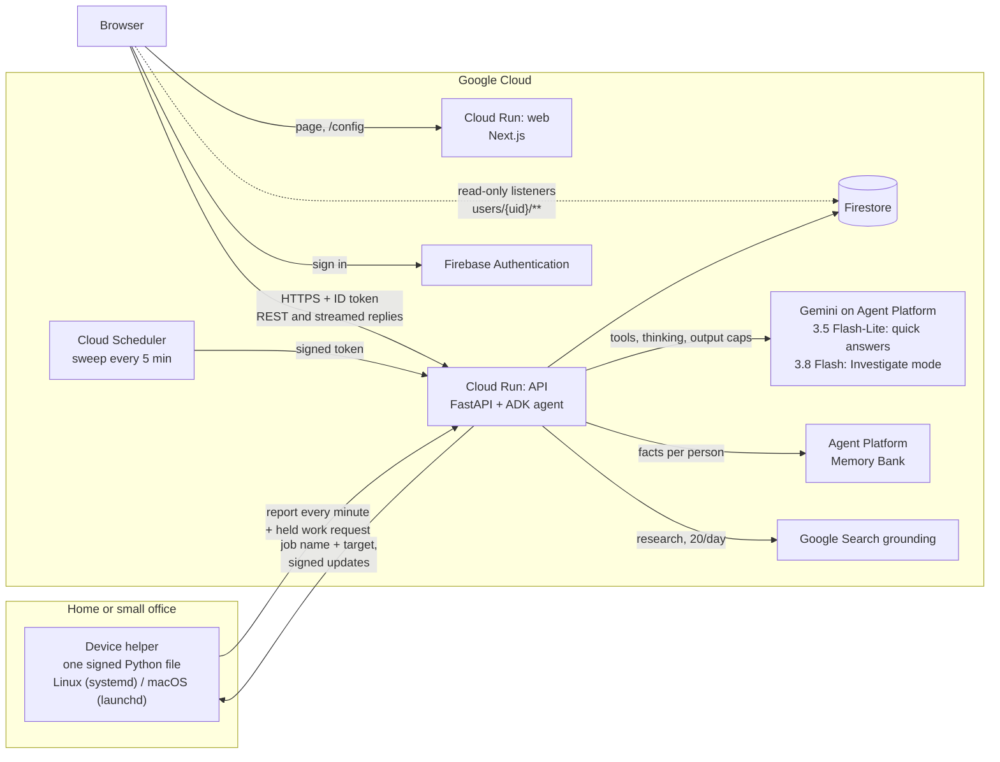

# Nightlight

Nightlight is a house-sitter for the computers you run at home or in a small office, for people who have no IT
person: it shows every device and what runs on it on one map, watches them, explains problems in plain words, and
fixes them only with your permission, earning more freedom one kind of job at a time.

**Live app:** https://nightlight-web-1032111130355.asia-northeast3.run.app (one click, no account needed)

Built for the Google Cloud AI Builder Cup 2026 (theme: Future of Work & Enterprise Productivity) by team **8yte**.
Everything here was written during the hackathon window.

## Try it in 30 seconds

1. Open the live app and choose the one-click demo. You get a **simulated sample home**, labelled "Sample": a
   Raspberry Pi (VPN and a car data logger), a Mac Mini (home automation), a NAS (photos and a nightly backup), a
   Minecraft server, a camera recorder and a router.
2. In the chat, ask: **"Is anything wrong at home?"**
3. Nightlight reads the devices, answers in two or three short sentences, and puts up an **approval card** for the
   most serious problem (the Pi's disk is 94% full; it offers to clean old logs). Nothing changes until you tap
   Approve.
4. Tap Approve. The job runs, the card updates, and the chat tells you what happened.

**Demo tools** lets you trigger more incidents (disk full, a lagging game server, an overdue backup, an available
update) and reset the sample home. Signing in with Google lets you add your own devices.

## The core loop

| Step | What Nightlight does | Where it lives |
|---|---|---|
| **Watches** | Each device shows a health light and one plain sentence ("The Minecraft world hasn't been backed up in 9 days"). A sweep every 5 minutes marks devices that stopped reporting and checks watched websites. | `api/.../sim.py`, `real.py`, `watch.py`, `main.py` (`/internal/sweep`) |
| **Explains in plain words** | A Gemini agent reads devices with tools and answers without jargon. Before answering "why is it full / slow / offline?" on a real device, it runs fixed read-only checks and answers with names and sizes. | `agent.py`, `playbooks.yaml`, helper `inspect` |
| **Asks before fixing** | Every change is an approval card: the plan, a dry run, what it touches, how to undo it, a risk badge. One tap approves or declines. | `actions.py`, `capabilities.py`, `web/components/ApprovalCard.tsx` |
| **Earns trust per kind of job** | After three approved successes of the same kind of job, Nightlight may offer to handle that job on its own. Risky jobs have a ceiling (restarting a game server always asks). A failure moves trust back down a step. Jobs on real devices always wait for a tap. | `trust.py`, `web/components/TrustPanel.tsx` |

Trust levels, in the words the app uses:

| Level | What the agent does |
|---|---|
| Always ask me | explains and waits for a tap |
| Ask me for new things | does familiar safe jobs on its own, asks about anything new |
| Just handle it and tell me | acts, then reports in plain words |

The trust ladder runs on the sample home. On real devices every restart, clean-up or update needs a tap, whatever the
trust settings say.

## What you get

| Area | In short |
|---|---|
| Map | a canvas on graph paper that opens fitted to any screen (pan, pinch or zoom); devices snap to the grid where you drop them; a list view too; lines between devices (connected through, backs up to, relies on, powered by) that the agent uses to reason about what depends on what; tags and filters; Live / Sample marks |
| Chat | streamed answers with the agent's steps shown; cards inline; history kept 30 days; starter questions when the chat is empty |
| Checkups (playbooks) | known problems (disk filling up, slow, no internet, updates, after a restart) written once as data; checks run, causes are matched in code, safe clean-ups come up as cards, with no AI call |
| Investigate mode | a toggle under the chat: a stronger model with high thinking and up to 24 steps works like an administrator and reports what it checked, found and recommends |
| Web research | for an error it does not recognise, one Gemini call grounded with Google Search, sources shown; 20 per person per day; the question is stripped of addresses, secrets and the home's own names first |
| Device notebook and profile | what Nightlight learned about each machine (causes, quirks, what worked), read before every investigation; the owner can edit it |
| Activity and history | who did what (you, the device, Nightlight); per real device, 24 hours or 7 days of disk, memory and CPU |
| Watched websites | up to 10 public addresses per account, checked from the cloud (status code and latency only) |
| Memory | short facts you tell the agent ("the kids play on weekends"), kept in Agent Platform Memory Bank; a panel lists them and forgets all |
| Knows itself | questions about Nightlight (adding, removing, updating, privacy) are answered from the product's own guide (`guide.yaml`) through a tool, never from memory |

## Architecture



A drawn version (generated from `docs/architecture/architecture.py`) is in
[`docs/architecture/architecture.png`](docs/architecture/architecture.png).

How the pieces talk:

- **Browser to API.** Every `/api/*` call carries a Firebase ID token. The user id comes only from that verified
  token; nothing in a request body can choose it. The browser reads its own data straight from Firestore with
  listeners (read-only, own subtree only, enforced by `firestore.rules`); every write goes through the API.
- **Chat.** A turn is one in-process ADK agent run. Replies stream as server-sent events. Every model call first
  reserves its worst-case cost in a Firestore transaction (see Budgets below). Things that happen outside the
  person's own messages (a job finished, a job declined, an investigation approved) are posted as **events**, not as
  fake user messages ([ADR 0002](docs/adr/0002-conversation-events.md)).
- **Approvals.** One Firestore transaction commits the decision, the device and service changes, the result, the
  trust update and the queued follow-up turn, so a job never runs twice.
- **Helper to API.** The helper reports health every minute (and right away after something changed) with a device
  token. Between reports it keeps one request open (`POST /helper/jobs/wait`); the server holds it for up to 25
  seconds and answers the moment an approved job appears, handing the job over at most once. The device only dials
  out; nothing is pushed into it ([ADR 0003](docs/adr/0003-job-channel.md)).
- **Capabilities.** Everything a real device can be asked to do is declared once in `capabilities.py`: how to build
  its card, how it is approved (on the device, one tap, or a passkey signature), and what follows from its result.
  One pipeline handles every capability ([ADR 0001](docs/adr/0001-capability-registry.md)).

## How we use Google Cloud

| Service | What it does here | Why |
|---|---|---|
| **Gemini on Google Agent Platform** | `gemini-3.5-flash-lite` (low thinking) answers everyday questions; `gemini-3.8-flash` (high thinking, up to 24 steps) runs Investigate mode | Flash-Lite answered faster in our tests with equally plain answers; the stronger model is a choice the person makes, with its own budget |
| **Agent Development Kit (ADK, Python)** | the agent loop, tools, callbacks before and after each model call (cost reservation, size checks, scrubbing) | one place to bound every call |
| **Agent Platform Memory Bank** | facts about the person, scoped to the verified user id, written only by the agent's `remember` tool, kept 180 days | memory that survives a cleared browser, without extracting it from transcripts behind the person's back |
| **Google Search grounding** | one grounded Gemini call for unknown errors, sources returned | the agent should not guess at error messages it has never seen |
| **Cloud Run** | the web app (Next.js) and the API (FastAPI); scale to zero, max 3 instances each | the judges' link stays up at near-zero idle cost |
| **Cloud Scheduler** | `POST /internal/sweep` every 5 minutes with a Google-signed token (audience and invoker checked) | silent devices and watched websites are noticed with nobody watching |
| **Firestore** | devices, services, history (TTL), approval cards, trust, chats, activity, quotas | transactions make approvals and job hand-over exactly-once; listeners give the browser live data |
| **Firebase Authentication** | Google sign-in, and anonymous sign-in for the one-click demo | judges never create an account; real devices are always tied to a Google account |
| **Firebase emulator** | the whole API test suite runs against the Firestore emulator | no cloud access needed to test |

No server-side API keys: the API reaches Firestore, Gemini and Memory Bank through its Cloud Run service account. The only key in the browser is the Firebase web config, which is public by design.

## The safety model

The hard problem in Nightlight is **safety against power and convenience**. The benchmark we hold ourselves to is a
person running an AI agent in a terminal with their own SSH keys: it can fix anything, and it is only as safe as the
person watching. Nightlight has to come close to that for people who have never opened a terminal, while staying safe
even if Nightlight's own cloud is breached. The full reasoning is in [`docs/DESIGN-trust.md`](docs/DESIGN-trust.md);
the code-level details are in [`docs/SECURITY.md`](docs/SECURITY.md).

| Layer | What it means |
|---|---|
| **Approval cards** | every change is proposed, never done. A card shows the plan, a dry run, what it touches, how to undo it (honestly, including "can't be undone") and a risk badge. The agent's tools create cards; they cannot run anything. |
| **Capability registry** | a real device can be asked for a fixed list of jobs: look into, look around (read-only checks), restart an allowed container or failed service, a safe clean-up from a fixed list, a signed helper update, remove the device, and expert commands. Unknown job types do nothing. |
| **Job names, not commands** | the cloud sends a job name and a target. The helper maps it to a fixed argument list, no shell, and re-checks the target against its own local allowlist and its current state before running. |
| **Signed helper** | the helper is one Python file plus a signature. It installs an update only if the signature matches the release key built into the running copy, the version is newer, and a self-test passes; the old copy is kept for `rollback`. The signing key never touches git, the image or the cloud; `deploy_api.sh` refuses to ship a release whose signature does not match. |
| **Strict vs app-managed** | chosen once at install. *Strict:* permissions change only on the device; the cloud cannot widen them. *Managed from the app:* the owner's switches in the app are applied by the helper, but only for targets the device itself reports, and every change still waits for a tap. |
| **Expert sessions with passkeys** | for anything beyond the fixed menu. The owner registers a passkey (WebAuthn, the same Face ID / Touch ID prompt as a password-free login) and pins its public key on each device at the device after comparing a fingerprint. Gemini proposes a command; the browser signs the exact command, device id, expiry (15 minutes) and a one-time nonce; the device verifies the signature itself before running. Read-only commands run under one signed 15-minute grant; the device enforces "read-only" with exact rules (fixed programs, reading sub-commands only, no pipes or chaining, no paths that look like secrets). A breached cloud cannot sign anything. |
| **Scrubbing** | log lines and check output are scrubbed on the device before they leave (keys, tokens, `key=value` secrets, URL credentials, emails, IP and hardware addresses, home paths). The server scrubs again every heartbeat value, job result, chat message, tool result, model output and memory fact before storing, showing or sending it to the model. Best effort, not a guarantee. |
| **What never leaves a device** | host names, IP or hardware addresses, files, environment variables, passwords or keys. The default device name comes from the hardware ("Raspberry Pi", "Mac mini"), never the host name. The server's schema rejects any field it does not expect. |
| **Device text is data** | names, tags, container names and log lines come from devices and are marked as evidence in the agent's instructions, never instructions. Discovery items use a fixed vocabulary the server checks. |
| **Budgets and quotas** | no model call happens unless a reservation for its worst-case cost succeeds first, in one Firestore transaction with the per-person, per-visitor and daily counters and a kill switch. Defaults: a $35 model budget, 120 calls per person per hour, 100 per visitor per hour, 2,000 per day, 40 turns per person per hour, 8 model calls and 8 tool calls per turn (24 in Investigate mode, 240 s), input bounded with Gemini's token counter, output plus thinking capped at 1,024 tokens (4,096 in Investigate mode), 20 web searches per person per day. |
| **Device tokens** | 256 random bits, stored only as a SHA-256 hash, revocable from the app or by uninstalling. Join codes are single use and expire in 10 minutes. |

Each step that added power was reviewed adversarially by a separate AI reviewer working from the code and the rules.
The first version of expert sessions came back with five high-severity findings (for example, "read-only" was a list
of names that `docker system prune` slipped through); each was fixed with a regression test and reviewed again.

## Measured performance

From [`docs/BENCHMARKS.md`](docs/BENCHMARKS.md): 10 runs of the demo story with `scripts/bench.py` against the real
model (`gemini-3.5-flash-lite`, low thinking, 1,024-token output cap) on Agent Platform, 2026-10-17. Firestore was the
local emulator, so Firestore network time is not included. 9 of 10 runs completed.

| Step | Median time to first words | Median full answer | 95th percentile | Model calls | Tool calls | Median cost |
|---|---|---|---|---|---|---|
| "Is anything wrong at home?" | 6.7 s | 6.7 s | 8.6 s | 3 | 2 | $0.0062 |
| Follow-up after approval | 2.7 s | 2.7 s | 4.6 s | 1 | 0 | $0.0002 |

Approving a card (one Firestore transaction): median 102 ms. The whole story (question, approval, follow-up) costs
about $0.0068. Worst case per model call under the enforced limits is $0.00736, so the $35 budget covers at least
4,755 calls; actual usage below the reservation is refunded.

The first version (2026-10-15, `gemini-3.8-flash`, fleet listed by tools, follow-up with tools) took 16.4 s for the
question and 14.0 s for the follow-up. Putting the home summary in the instruction, switching to Flash-Lite and
making the follow-up a single call brought it to the numbers above.

## Sample questions

On the sample home, these are known to work:

| Ask | What happens |
|---|---|
| "Is anything wrong at home?" | the Pi's disk is 94% full; a card offers to clean old logs |
| "My kids say Minecraft is really laggy tonight" | memory nearly full; a card offers to restart the server (and says players will be disconnected) |
| "When was the Minecraft world last backed up?" | the answer, and a card to back it up if it is overdue |
| "Is there an update for the game server?" | version and latest version; a card to back up then update |
| "What depends on the router?" | reasons from the lines on the map |
| "How do I add my own device?" | answered from the built-in guide |
| "Remember that the kids play on weekends" | saved to Memory Bank; shown in the Memory panel |

Answers are kept short on purpose. Very long conversations are trimmed or refused rather than cut off silently.

## Real devices

Signed in with Google, open **Add a device**. The app shows a one-line install command for Linux or macOS. The
installer downloads the helper from the same web address, checks its sha256, joins with a one-time code (or shows a
code and a QR code for you to approve on your phone), and installs a background service that runs as your normal
user. On a Mac it asks once, there and then, whether it may measure Downloads, Desktop, Documents, Movies and the
Trash, so nobody has to come back to the terminal for it. If someone else set the device up for you, **Send to whoever
set up this device** shares the line with three plain steps. The helper is [`helper/nightlight_helper.py`](helper/nightlight_helper.py): Python 3.8+, standard library
only, about 2,500 lines, reviewable in one sitting.

It changes nothing by default. What it can do, and only after you allow it:

| You allow | Nightlight can |
|---|---|
| `diagnose NAME` (or the "look into" switch) | read why a container or service is down, read-only, no card |
| `logs NAME` | include its last 30 log lines, scrubbed on the device |
| `inspect` (or the "check why" switch) | run fixed read-only checks: biggest known folders, busiest programs, waiting updates, Docker disk use, DNS and internet, load, failing services |
| `restart_container NAME` / `restart_service UNIT` | restart that one target, after your tap, only if it is stopped or failed |
| `fix` (or the "clean up space" switch) | one clean-up from a fixed list (Trash, Homebrew / npm caches, Xcode build data, unused Docker images, apt cache, system journal), after your tap |
| `update` (or the "updates" switch) | install a signed, newer helper after your tap (or automatically if you say so) |
| `nightlight expert` at the device | pin your passkey so expert sessions can run commands you sign |

Removing a device is a card too: the helper uninstalls itself and the device leaves the map.

## Honest limits

- Real-device jobs are the fixed list above plus passkey-signed expert commands. Everything else is explained, not
  changed.
- The trust ladder (jobs running on their own) applies to the sample home only.
- The helper supports Linux (systemd) and macOS (launchd). **Windows is not supported.**
- Adding a device needs one line in a terminal. There are no installers yet.
- Lines between devices on the map are drawn by the owner (or by the agent when you tell it how two devices relate).
  Nightlight does not yet work them out from what devices see of each other.
- A device token has no expiry; it is revocable but not rotated.
- `curl | sh` trusts the HTTPS origin; the sha256 pin only proves the helper matches what that server serves.
- A job handed to a helper that crashes before reporting stays "running"; a job approved while the device is offline
  waits until it reports again.
- There is no "delete my account" yet; removed devices are archived 30 days, then deleted ("forget for good" deletes
  them now).
- Browser notifications work only while the tab is open.
- Scrubbing is pattern-based and best effort. The design relies first on not collecting secrets.

## Roadmap

- Installers (a macOS package, a Raspberry Pi image, NAS packages) so the first install needs no terminal.
- Lines on the map worked out automatically from what devices can see of each other, keyed so that nothing about
  the network itself leaves the home.
- Windows support for the helper.
- Device token rotation and expiry; release signing in a hardware security module or CI outside the cloud.
- Retention you choose per account, and account deletion that purges everything at once.
- A local-first mode: the helper keeps watching and answering on the home network when the cloud is away.
- Teams: a family member or an office manager with their own role.

## Run locally

Requirements: Python 3.12 with [uv](https://docs.astral.sh/uv/), the Firebase CLI and Java 21 (for the Firestore
emulator), Node.js 20+.

```bash
./scripts/test_api.sh                  # API and helper tests against the Firestore emulator; no cloud access needed
./scripts/secret_scan.sh               # secret scan of staged changes and history
cd web && npm install && npm run dev   # web app on http://localhost:3000 (environment: see web/README.md)
```

The API runs with no Memory Bank id locally (memory becomes a no-op) and with the emulator as Firestore. The test
suite has about 350 tests across the agent, approvals, trust, the helper client, pairing, expert sessions, playbooks,
research, reset and the cost guards.

## Deploy

```bash
./scripts/deploy_api.sh   # Cloud Run: verifies the helper's signature, copies the signed release in, deploys
./scripts/deploy_web.sh   # Cloud Run: reads the public Firebase web config at deploy time, deploys, moves traffic
```

Both scripts run the secret scan first. **No secrets live in git or in the images.** Model, thinking level, prices,
budget and quota limits are environment variables set at deploy (`api/src/nightlight_api/config.py` lists them all
with their defaults). The API reaches Firestore, Gemini and Memory Bank through its service account. The web app
serves its Firebase config (public by design) from `/config`, read from environment variables. `.env*`, `*.pem` and
service-account files are gitignored; a scan (`.gitleaks.toml`) gates every deploy.

## Repo map

| Path | What |
|---|---|
| `api/src/nightlight_api/agent.py` | the ADK agent: instruction, tools, callbacks that bound every model call |
| `api/src/nightlight_api/capabilities.py` | the registry of everything a real device can be asked to do |
| `api/src/nightlight_api/actions.py` | approval cards: request, decide, job result (one pipeline) |
| `api/src/nightlight_api/trust.py`, `sim.py`, `template.py`, `demo.py` | the trust ladder and the simulated sample home |
| `api/src/nightlight_api/real.py` | real devices: joining, heartbeats, findings, job hand-over |
| `api/src/nightlight_api/expert.py` | passkey registration and signing for expert sessions |
| `api/src/nightlight_api/playbooks.py`, `playbooks.yaml` | known problems as data |
| `api/src/nightlight_api/research.py` | Google Search grounded research |
| `api/src/nightlight_api/memory.py`, `notebook.py` | Memory Bank facts; per-device notebook |
| `api/src/nightlight_api/quota.py`, `redact.py`, `fence.py` | cost reservations, scrubbing, turn leases |
| `api/src/nightlight_api/release.py`, `scripts/sign_helper.sh` | signed helper releases |
| `api/src/nightlight_api/guide.yaml` | what the agent says about Nightlight itself |
| `api/tests/` | the test suite (`fake_llm.py` stands in for Gemini) |
| `helper/nightlight_helper.py`, `.sig` | the device helper and its release signature |
| `web/` | Next.js app: `components/` (Board, Chat, ApprovalCard, TrustPanel, ExpertSessions, Checkups, ...), `lib/` (Firebase, API, listeners, passkeys), `app/install.sh` and `app/uninstall.sh` routes |
| `docs/API.md` | the contract between web, helper and API |
| `docs/SECURITY.md`, `docs/DESIGN-trust.md` | the security model; safety vs power, and why |
| `docs/adr/` | decisions: capability registry, conversation events, held job channel |
| `docs/BENCHMARKS.md`, `scripts/bench.py` | measured latency and cost |
| `docs/architecture/` | the architecture diagram as code |
| `contracts/mocks/` | sample data for every state of the demo story |
| `firebase.json`, `firestore.rules` | emulator settings; browsers read only their own data |
| `scripts/` | tests, secret scan, deploys, benchmark, smoke tests, mock generation |

## Team

**8yte**

| Who | Role |
|---|---|
| Jeong Hwan Park | lead: product, backend, agent, helper |
| Sadika | frontend and design |
