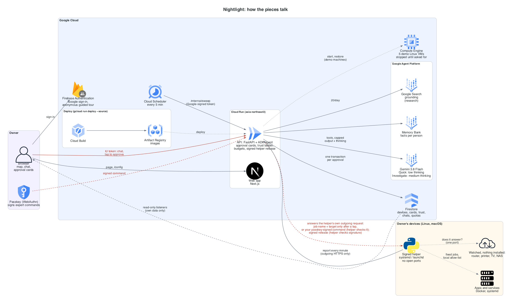

# Nightlight

**A house-sitter for your home and small-office servers.** Nightlight shows every device you run, and what runs on
it, on one friendly map. A Gemini agent keeps watch, explains problems in plain words, and fixes them with your
permission. It starts by asking about everything and earns more freedom one kind of job at a time, only when you say so.

Built for the Google Cloud AI Builder Cup 2026 (category: Future of Work & Enterprise Productivity).

> Status: working end to end. The API and the web app run on Cloud Run; the helper runs on real Linux devices
> (tested on a Raspberry Pi) and on macOS.

## Who it's for

People who run a few machines that matter to them but have no IT person: a family with a NAS full of photos, a
Raspberry Pi running a home VPN or an ad blocker, home automation, someone hosting a Minecraft world for their kids, a
dental clinic or a small office. Existing AI operations tools are built for engineers (terminals, chat windows, one
on/off switch for the agent). Nightlight is visual and plain-language.

## How it works

1. **See everything.** Devices sit on a map and hold the services that run on them. Each shows a health light and one
   plain sentence ("The Minecraft world hasn't been backed up in 9 days").
2. **Ask.** "Is anything wrong at home?" The agent reads the devices with tools and answers in a few short sentences.
3. **Approve.** When a fix helps, the agent proposes it on an approval card: what it will do, a dry run, what it
   touches, how to undo it, and a risk badge. Nothing changes until you tap Approve.
4. **Trust grows, one kind of job at a time.** After three approved successes of the same kind of job on the sample
   home, Nightlight may offer to handle that job on its own (only jobs allowed to run on their own, and not pinned by
   you). Risky jobs have a ceiling (restarting a game server always asks); a failure moves an unpinned job's trust
   back down a step. **Jobs on real devices always wait for a tap**, whatever the trust settings.

| Trust level | What the agent does |
|---|---|
| Always ask me | explains and waits for a tap |
| Ask me for new things | does familiar safe jobs on its own, asks about anything new |
| Just handle it and tell me | acts, then reports in plain words |

## Try it

- **One-click demo (no account):** you get a **simulated sample home**, clearly labelled "Sample": a Raspberry Pi
  with a VPN and a car-data logger, a Mac Mini running home automation, a NAS, a Minecraft server, a camera recorder
  and a router. A demo panel triggers incidents: disk full, a failing job, a lagging game server, an overdue backup,
  an available update. Reset rebuilds it.
- **Signed in with Google:** you start with only your own devices. The sample home can be shown or hidden with one
  switch; your real devices are never touched by it or by Reset.

Questions that work on the sample home: "Is anything wrong at home?" (the Pi's disk is 94% full; it proposes cleaning
old logs), "My kids say Minecraft is really laggy tonight" (memory nearly full; it proposes a restart), "When was the
Minecraft world last backed up?", "Is there an update for the game server?"

## Real devices (the helper)

A small Python script ([`helper/nightlight_helper.py`](helper/nightlight_helper.py), Python 3.8+, standard library,
psutil if present) reports health facts every minute. Adding a device needs a Google sign-in.

| Task | How |
|---|---|
| Add (code from the app) | `curl -fsSL <web>/install.sh \| sh -s -- ABCD-EFGH` (the line is shown in Add a device; the code is single use, valid 10 minutes) |
| Add (code shown by the device) | `curl -fsSL <web>/install.sh \| sh`: the device prints a code, a link and, if `qrencode` is installed, a QR code; approve it in the app or on your phone |
| Update the helper | the same line without a code, on a device that has already joined |
| Remove | `curl -fsSL <web>/uninstall.sh \| sh`: stops the service, deletes the helper's files, revokes the device's key |

The installer downloads the helper from the same web address, checks its sha256, joins, and installs a background
service (systemd on Linux, a LaunchAgent on macOS) that runs as your normal user.

**What it sends:** OS name and CPU type; CPU, memory and disk percentages; uptime; Docker containers (name, image name
and tag without registry or path, state, status text); names of failed system services; how many software updates are
waiting; on macOS, labels of your own background items that keep failing; two safety checks (can this account use
administrator rights without a password; does SSH allow password logins); the list of jobs you allowed on the device;
up/down results for things it watches for you.

**What it never sends:** host names, IP or hardware addresses, files, environment variables, passwords or keys. Logs
leave the device only for a target you allowed with `allow logs`, as the last 30 lines, scrubbed on the device first.
It talks only HTTPS to the address it joined, never follows redirects, and keeps its token in an owner-only file.

**It changes nothing by default.** At install the device chooses one of two modes:

- **Managed from the app** (default): you switch permissions on and off in the device's panel. This delegates that
  choice to your Nightlight account: the app (and so, in the worst case, a compromised server) can grant the
  built-in jobs, but only for things the device itself reports, and every restart still waits for a tap.
- **Strict**: permissions change only on the device; the server can't widen them.

Either way the helper re-checks every action before running it. In strict mode, or by hand:

```bash
H=~/.local/share/nightlight/nightlight_helper.py     # macOS: ~/Library/Application\ Support/Nightlight/
python3 $H allow restart_container <NAME>   # restart this stopped container (after your tap on the card)
python3 $H allow restart_service <UNIT>     # restart this failed system service (after your tap; needs sudo -n)
python3 $H allow diagnose <NAME>            # let the agent "look into" why it is down (read-only, no card)
python3 $H allow logs <NAME>                # ...and include its last log lines (scrubbed here first)
python3 $H disallow <JOB> <NAME>            # take it back
python3 $H show                             # print exactly what a report would send
python3 $H discover                         # find things nearby; you pick what to send
```

**Restarting a service** needs administrator rights. The helper uses `sudo -n` (it never asks for or stores a
password), so allow that one service once on the device:

```bash
echo "$USER ALL=(root) NOPASSWD: /usr/bin/systemctl restart pihole-FTL.service" \
  | sudo tee /etc/sudoers.d/nightlight-pihole && sudo chmod 0440 /etc/sudoers.d/nightlight-pihole
```

Raspberry Pi OS's default user can already use `sudo` without a password (Nightlight reports this as a safety
finding), so there the `allow` line is enough. Every restart still waits for your tap, and only a unit systemd
reports as failed is restarted.

**Discovery** runs only when you start it on the device. It reads the neighbour table, mDNS (Linux) and a fixed list
of 8 ports, prints what it found, and sends only the items you pick: a random id, a plain guess ("Printer"), the
maker and service words. Addresses stay on the device. An item you add becomes a device on your map that the helper
checks every minute (a TCP connect to a port it saw open).

## Features

| Area | What you get |
|---|---|
| Map | devices on a grid you can drag; rename real devices; tags (up to 6) with filter chips; Live / Sample marks and a colour key |
| Approval cards | plan, dry run, what it touches, how to undo, risk badge; one tap approves or declines |
| Trust ladder | per kind of job, device or service; pinning; promotion offers after 3 successes (sample home) |
| Look into | "why is it down?" on real devices: status, exit-code meaning, out-of-memory, restarts, optional log lines; answered in the chat or by one follow-up |
| Investigates first | before answering "why is it full / slow / offline?", the agent runs the helper's fixed read-only checks (biggest known folders, busiest programs, waiting updates, Docker disk use, DNS and internet, load, failing services) and answers with names and sizes |
| Playbooks | known problems (disk filling up, slow, internet, updates) written down once as data (`api/src/nightlight_api/playbooks.yaml`): checks run, causes are matched in code and safe clean-ups come up as cards, with no AI call; "Checkups" in the device drawer, or `run_playbook` in chat |
| Safe clean-ups | empty the Trash, Homebrew / npm caches, Xcode build data, unused Docker images, apt cache, system journal; each one an approval card that says honestly whether it can be undone, and reports the space freed |
| Signed updates from the app | "Update available" on a device, one tap; the helper installs a new version only if it is signed with Nightlight's offline release key, is newer and passes a self-test, keeps the old one (`nightlight rollback`); optional "install signed updates automatically" |
| Remove a device | "Remove Sadika's Mac" in the chat (a card) or "Remove this device…" under the device: the helper uninstalls itself (or, if the device is silent or its helper too old, its access is cut at once) and the device leaves the map; its history, notes and activity stay archived 30 days, then are deleted ("forget for good" deletes them now) |
| Knows itself | the agent answers questions about Nightlight (adding, removing, updating, uninstalling, remote access, privacy) from the product's own guide (`api/src/nightlight_api/guide.yaml`) through a tool, never from memory |
| Device notebook | Nightlight notes what it learned about a device (causes, quirks, what worked) and reads it before investigating; owners add their own notes |
| Known and snoozed problems | "I know, leave it" or "Snooze a week"; the health light counts only problems that still need a look; a problem that gets worse comes back |
| Activity | who did what (you, the device, Nightlight), filters by device, kind and time, grouped by day |
| History | per real device, last 24 hours or 7 days: status strip and disk, memory, CPU sparklines (points every 5 minutes, kept 8 days) |
| Keeps watch | a scheduled sweep every 5 minutes marks devices that stopped reporting and checks watched websites; browser notifications for serious events while the tab is open; "while you were away" summary |
| Watched websites | up to 10 public web addresses per account, checked from the cloud (status code and latency only) |
| Discovery | "Found nearby" list from a helper; add an item as a watched device |
| Mac and safety checks | macOS updates and failing background items; passwordless administrator rights; SSH password logins |
| Memory | short facts you tell the agent ("the kids play on weekends"), kept in Agent Platform Memory Bank; a panel lists them and forgets all |

## Architecture



(Drawn from code: `uv run --with diagrams python docs/architecture/architecture.py`.)

```
Browser (Next.js on Cloud Run) ── Firebase Authentication (Google sign-in, one-click anonymous demo)
   │  HTTPS + ID token (REST + streamed replies)          Firestore (read-only listeners on users/{uid}/**)
   ▼                                                              ▲
Nightlight API on Cloud Run (FastAPI) ────────────────────────────┘
   ├─ Gemini agent (ADK, in-process) ── Gemini 3.5 Flash-Lite on Google Agent Platform
   ├─ Agent Platform Memory Bank (facts per user)
   └─ POST /internal/sweep  ◄── Cloud Scheduler, every 5 minutes, Google-signed token
Helper on each real device ── HTTPS + device token ──► /helper/* routes of the same API
```

- **The uid comes only from the verified Firebase token**, and every record lives under that user. Browsers may only
  read their own subtree (`firestore.rules`); every write goes through the API.
- **Every approval is one Firestore transaction**: the decision, device and service changes, result, trust update and
  the queued follow-up turn commit together, so a job never runs twice (tested with 10 simultaneous approvals).
- **The agent proposes, it never acts directly.** Action tools create approval cards; only approved (or, on the
  sample home, explicitly trusted) jobs run. Real jobs run on the device, handed over at most once.
- **Reset is safe under concurrency**: a barrier blocks all demo writes while the sample home is re-created.

## Google technology

| Service | Use |
|---|---|
| Gemini on Google Agent Platform | reasoning and plain-language explanations (3.5 Flash-Lite, low thinking; model, thinking level and prices are set together at deploy) |
| Agent Development Kit (ADK, Python) | tools, the agent loop and streaming |
| Agent Platform Memory Bank | what Nightlight remembers about each person, scoped per user |
| Cloud Run | hosts the API and the web app; scales to zero |
| Cloud Scheduler | the 5-minute sweep (silent devices, watched websites), with an OIDC token |
| Firestore | devices, services, history (TTL), approval cards, trust, chats, activity; rules keep each user's data private |
| Firebase Authentication | Google sign-in and the anonymous one-click demo |

## Guardrails

- **Approval before action**, with dry run, blast radius, rollback and a risk badge; risk ceilings on the trust ladder.
- **Secrets are scrubbed** from chat text, tool results, model output, device reports and history before they are
  stored, shown or sent to the model (best effort; patterns plus sensitive keys). The helper scrubs log lines on the
  device before they leave.
- **Device text is data, not instructions.** Names, tags and log lines from devices are marked as evidence in the
  agent's instructions; discovery items use a fixed vocabulary checked by the server.
- **Cost is bounded before any model call**: each call reserves its worst-case cost against a model budget, with
  per-user, per-visitor and daily limits and a kill switch; input size is checked with Gemini's token counter and
  output (including thinking) is capped.
- **Stale work can't land**: chat turns hold a lease; after a reset or a takeover a stale turn can't reserve new model
  calls or commit results.

## Security model

Two surfaces: **users → API** (Firebase ID token) and **helper → API** (device token). In short:

- Device tokens are random (256 bits), stored only as a SHA-256 hash, and revocable from the app or by uninstalling.
- The server sends a job name and a target, never a command. The helper runs fixed argument lists, no shell, only
  for job types built into it and targets allowed in its local config. **The local allowlist is final.** What a
  compromised cloud could do to a device: ask it to restart a container or unit you allowed, or read the status
  (and logs, if allowed) of a target you allowed. Nothing else.
- Scrubbing on the device and on the server is best effort, not a guarantee.
- Watched websites: every resolved address must be public; the check connects to that exact checked IP (TLS still
  verifies the real host name), reads only the status line and never follows redirects.

Known limits, stated plainly: a device token has no expiry (it is revocable; rotation is on the roadmap);
`curl | sh` trusts the HTTPS origin, and the sha256 pin only proves the helper matches what the same server serves;
a job handed to a helper that crashes before reporting stays "running". Details: [`docs/SECURITY.md`](docs/SECURITY.md).

## Data sources

The sample home's devices and incidents are **synthetic** and labelled as such. Real devices show only what their
helper reported. Health checks are deterministic rules over device data; the model explains them. It is instructed to
use only the supplied summary and its tools, but generated explanations can still be wrong; the approval card shows
the facts from the device data.

## Performance

Measured against the real model with `scripts/bench.py` on the sample home (details in
[`docs/BENCHMARKS.md`](docs/BENCHMARKS.md)): question about 5.2 s (median), follow-up after approval about 2.1 s, about
$0.0036 for the whole story (measured 2026-10-16 with the current feature set).

## Run locally

Requirements: Python 3.12 with [uv](https://docs.astral.sh/uv/), the Firebase CLI and Java 21 (for the Firestore
emulator), Node.js for the web app.

```bash
./scripts/test_api.sh            # the API and helper tests against the Firestore emulator (no cloud access needed)
./scripts/secret_scan.sh         # secret scan of staged changes and history
cd web && npm install && npm run dev   # the web app; see web/README.md for its environment
```

Deploy: `scripts/deploy_api.sh` and `scripts/deploy_web.sh` (no secrets; settings come from the environment). The API
contract is in [`docs/API.md`](docs/API.md); sample data for every state is in [`contracts/mocks/`](contracts/mocks/).

## Known limits

- Real-device jobs are a fixed list: read-only checks, restarting an allowed container or failed system service, safe
  clean-ups, signed helper updates and removing the device. Everything else is explained, not changed. The trust
  ladder applies to the sample home only.
- There is no "delete my account" yet; removed devices are deleted after 30 days or at once with "forget for good".
- A real job approved while its device is offline waits until the device reports again (or a reset withdraws it).
- Discovery needs the owner to run it on the device; mDNS discovery is Linux only. Restarting services needs systemd.
- Browser notifications work only while the tab is open (no push service).
- Answers are kept short on purpose; very long conversations are trimmed or refused rather than cut off silently.
- The approval card's "undo" is simulated on the sample home.

## Roadmap

- Installers for macOS and Windows apps and for NAS systems (Synology, QNAP), beyond the one-line script.
- A local-first command center: the helper keeps working and answering on the home network when the cloud is away.
- Teams and sharing: a family member or an office manager with their own role.
- A skills library: more allowed jobs (clean logs, back up, update) with the same on-device allowlist.
- A power-user terminal view for people who want the commands behind each card.
- Device token rotation and expiry.
