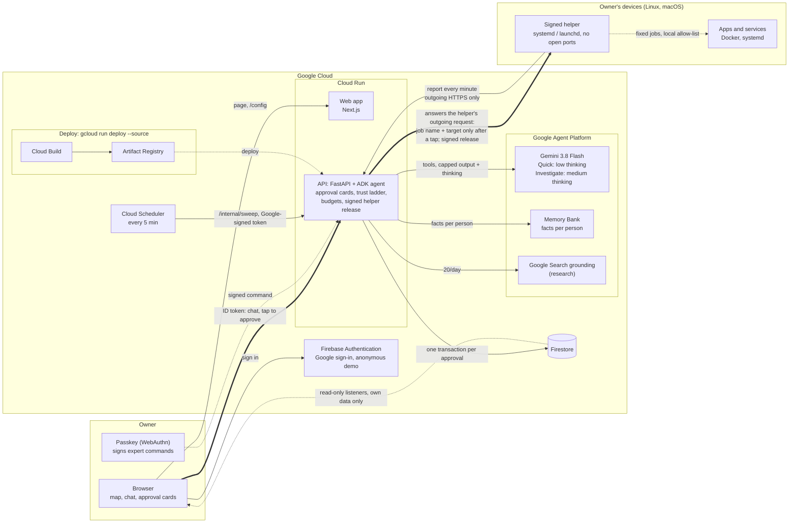

# Nightlight

Nightlight is a house-sitter for the computers you run at home or in a small office, for people with no IT person.
It shows every device and what runs on it on one map. It watches them, explains problems in plain words, and fixes
them only with your permission, earning more freedom one kind of job at a time.

**Live app:** https://nightlight-web-1032111130355.asia-northeast3.run.app (one click, no account needed)

Built for the Google Cloud AI Builder Cup 2026 (theme: Future of Work & Enterprise Productivity) by team **8yte**.
Everything here was written during the hackathon window.

**What we tested, what is wrong, and what comes next:** [`docs/LIMITS-AND-ROADMAP.md`](docs/LIMITS-AND-ROADMAP.md).

## Try it in 30 seconds

1. Open the live app and tap "Try the demo (no account)". You get a **simulated sample home**, labelled "Sample": a
   Raspberry Pi (VPN and a car data logger), a Mac Mini (home automation), a NAS (photos and a nightly backup), a
   Minecraft server, a camera recorder and a router.
2. In the chat, ask: **"Is anything wrong at home?"**
3. Nightlight reads the devices, answers in two or three short sentences, and puts up an **approval card** for the
   most serious problem (the Pi's disk is 94% full; it offers to clean old logs). Nothing changes until you tap
   Approve.
4. Tap Approve. The job runs, the card updates, and the chat tells you what happened.

**Demo tools** lets you trigger more incidents (disk full, a lagging game server, an overdue backup, an available
update) and reset the sample home. Signing in with Google lets you add your own devices.

## The core loop

| Step | What Nightlight does | Where it lives |
|---|---|---|
| **Watches** | Each device shows a health light and one plain sentence ("The Minecraft world hasn't been backed up in 9 days"). A sweep every 5 minutes marks devices that stopped reporting and checks watched websites. | `api/.../sim.py`, `real.py`, `watch.py`, `main.py` (`/internal/sweep`) |
| **Explains in plain words** | A Gemini agent reads devices with tools and answers without jargon. Before answering "why is it full / slow / offline?" on a real device, it runs fixed read-only checks and answers with names and sizes. | `agent.py`, `playbooks.yaml`, helper `inspect` |
| **Asks before fixing** | Every change is an approval card: the plan, a dry run, what it touches, how to undo it, a risk badge. One tap approves or declines. A card exists only when the model called the tool that makes it; the chat shows each card and each step from server events, never from the model's words, and the server never edits an answer to match them. | `actions.py`, `capabilities.py`, `agent.py`, `turns.py`, `web/components/ApprovalCard.tsx` |
| **Earns trust per kind of job** | After three approved successes of the same kind of job, Nightlight may offer to handle that job on its own. Risky jobs have a ceiling (restarting a game server always asks). A failure moves trust back down a step. Jobs on real devices always wait for a tap. | `trust.py`, `web/components/TrustPanel.tsx` |

Trust levels, in the words the app uses:

| Level | What the agent does |
|---|---|
| Always ask me | explains and waits for a tap |
| Ask me for new things | does familiar safe jobs on its own, asks about anything new |
| Just handle it and tell me | acts, then reports in plain words |

The trust ladder runs on the sample home. On real devices every restart, clean-up or removal needs a tap, whatever the
trust settings say; only signed helper updates may install on their own, and only if you allowed that.

## What you get

| Area | In short |
|---|---|
| Map | a canvas on graph paper that opens fitted to any screen (pan, pinch or zoom); devices snap to the grid where you drop them; a list view too; draw a line by dragging from one device to another (works by touch); Tab and Enter open a device; lines between devices (connected through, backs up to, relies on, powered by) that the agent uses to reason about what depends on what; tags and filters; Live / Sample marks |
| Cards that open in place | a device's card opens on the map to show its apps (needs-a-look first, then starred, up to twelve); tap an app for its own view: what it is in one plain line, how it is, its version, and the notes, fixes and jobs about it |
| Favorites | star a device or any of its apps; up to three starred apps show on the device's card; a Favorites chip narrows the map |
| Device drawer | a panel from the left with one job per tab (Overview, Apps, Knowledge, Settings); the map stays usable beside it |
| The map follows the chat | devices the agent's steps work on glow while it works; when it is done the main one opens with the apps it named pulsing; it never moves the view while you are touching the map, and with reduced motion the view moves without animation |
| Chat | streamed answers with the agent's steps shown; it first says what it will look at; Quick, or Investigate (the "Investigate deeply" toggle); a Stop button that keeps what was already done; cards inline; history kept 30 days; replies in the language you write in |
| Honest agent | says plainly what Nightlight can't do (Windows, jobs it has no tool for), never hands out commands to type, and when you ask for something safer offers only alternatives it really has |
| Checkups (playbooks) | known problems (disk filling up, slow, no internet, updates, after a restart) written once as data; checks run, causes are matched in code, safe clean-ups come up as cards, with no AI call |
| Investigate | a toggle under the chat: a stronger model (medium thinking, up to 24 steps) works like an administrator and reports what it checked, found and recommends |
| Web research | for an error it does not recognise, one Gemini call grounded with Google Search, sources shown; 20 per person per day; the question is stripped of addresses, secrets and the home's own names first |
| Knowledge per device | like an administrator's folder: a profile, notes grouped by app, runbooks (fixes that worked there, offered again as cards) and a log of every job that ran; read before every investigation; the owner can edit it |
| Found nearby | your devices list what else is on the network, with the names and models things announce: Apple devices and printers through Bonjour, the router through UPnP. Add one and Nightlight watches whether it answers |
| Activity and history | who did what (you, the device, Nightlight); per real device, 24 hours or 7 days of disk, memory and CPU |
| Watched websites | up to 10 public addresses per account, checked from the cloud (status code and latency only) |
| Memory | short facts you tell the agent ("the kids play on weekends"), kept in Agent Platform Memory Bank; a panel lists them and forgets all |
| Knows itself | questions about Nightlight (adding, removing, updating, privacy) are answered from the product's own guide (`guide.yaml`) through a tool, never from memory |

## Architecture


The same picture in Mermaid (the PNG is generated by `docs/architecture/architecture.py`; keep the two in step):



How the pieces talk:

- **Browser to API.** Every `/api/*` call carries a Firebase ID token. The user id comes only from that verified
  token; nothing in a request body can choose it. The browser reads its own data straight from Firestore with
  listeners (read-only, own subtree only, enforced by `firestore.rules`); every write goes through the API.
- **Chat.** A turn is one in-process ADK agent run. Replies stream as server-sent events (the browser keeps one connection open and words arrive as they are written). Every model call first
  reserves its worst-case cost in a Firestore transaction (see Budgets below). Things that happen outside the
  person's own messages (a job finished, a job declined, an investigation approved) are posted as **events**, not as
  fake user messages ([ADR 0002](docs/adr/0002-conversation-events.md)).
- **Approvals.** One Firestore transaction commits the decision, the device and service changes, the result, the
  trust update and the queued follow-up turn, so a job never runs twice.
- **Helper to API.** The helper reports health every minute (and right away after something changed) with a device
  token. Between reports it keeps one request open (`POST /helper/jobs/wait`); the server holds it for up to 25
  seconds and answers the moment an approved job appears, handing the job over at most once. The device only dials
  out; nothing is pushed into it ([ADR 0003](docs/adr/0003-job-channel.md)).
- **Capabilities.** Everything a real device can be asked to do is declared once in `capabilities.py`: how to build
  its card, how it is approved (on the device, one tap, or a passkey signature), and what follows from its result.
  One pipeline handles every capability ([ADR 0001](docs/adr/0001-capability-registry.md)).

## How we use Google Cloud

| Service | What it does here | Why |
|---|---|---|
| **Gemini on Google Agent Platform** | `gemini-3.8-flash` for both modes: everyday questions at low thinking with a few steps; Investigate mode at medium thinking with up to 24 steps and its own budget | On 18 Oct we moved everyday answers from 3.5 Flash-Lite to 3.8 Flash: on the same 12 demo questions, run 3 times each, Flash-Lite passed 26 of 36 and Flash 34 of 35, at about twice the time per answer (median 9.0 s against 4.6 s) and 2.5 times the cost |
| **Agent Development Kit (ADK, Python)** | the agent loop, tools, callbacks before and after each model call (cost reservation, size checks, scrubbing) | one place to bound every call |
| **Agent Platform Memory Bank** | facts about the person, scoped to the verified user id, written only by the agent's `remember` tool, kept 180 days | memory that survives a cleared browser, without extracting it from transcripts behind the person's back |
| **Google Search grounding** | one grounded Gemini call for unknown errors, sources returned | the agent should not guess at error messages it has never seen |
| **Cloud Run** | the web app (Next.js) and the API (FastAPI); scale to zero, max 3 instances each | the judges' link stays up at near-zero idle cost |
| **Cloud Scheduler** | `POST /internal/sweep` every 5 minutes with a Google-signed token (audience and invoker checked) | silent devices and watched websites are noticed with nobody watching |
| **Firestore** | devices, services, history (expires on its own), approval cards, trust, chats, activity, quotas | transactions make approvals and job hand-over exactly-once; listeners give the browser live data |
| **Firebase Authentication** | Google sign-in, and anonymous sign-in for the one-click demo | judges never create an account; real devices are always tied to a Google account |
| **No stored secrets (keyless)** | the API reaches Firestore, Gemini and Memory Bank as its own Cloud Run service account; there are no API keys, so nothing goes in Secret Manager. The helper's release-signing key stays offline on the team's machine | a cloud compromise can't leak a key or sign a helper update |
| **Firebase emulator** | the whole API test suite runs against the Firestore emulator | no cloud access needed to test |

No server-side API keys: the API reaches Firestore, Gemini and Memory Bank through its Cloud Run service account. The only key in the browser is the Firebase web config, which is public by design.

## The safety model

The hard problem in Nightlight is **safety against power and convenience**. The benchmark we hold ourselves to is a
person running an AI agent in a terminal with their own SSH keys: it can fix anything, and it is only as safe as the
person watching. Nightlight has to come close to that for people who have never opened a terminal, while staying safe
even if Nightlight's own cloud is breached. The full reasoning is in [`docs/DESIGN-trust.md`](docs/DESIGN-trust.md);
the code-level details are in [`docs/SECURITY.md`](docs/SECURITY.md).

| Layer | What it means |
|---|---|
| **Approval cards** | every change is proposed, never done. A card shows the plan, a dry run, what it touches, how to undo it (honestly, including "can't be undone") and a risk badge. The agent's tools create cards; they cannot run anything. |
| **Capability registry** | a real device can be asked for a fixed list of jobs: look into, look around (read-only checks), restart an allowed container or failed service, a safe clean-up from a fixed list, a signed helper update, remove the device, and expert commands. Unknown job types do nothing. |
| **Job names, not commands** | the cloud sends a job name and a target. The helper maps it to a fixed argument list, no shell, and re-checks the target against its own local allowlist and its current state before running. |
| **Signed helper** | the helper is one Python file plus a signature. It installs an update only if the signature matches the release key built into the running copy, the version is newer, and a self-test passes; the old copy is kept for `rollback`. The signing key never touches git, the image or the cloud; `deploy_api.sh` refuses to ship a release whose signature does not match. |
| **Strict vs app-managed** | chosen once at install. *Strict:* permissions change only on the device; the cloud cannot widen them. *Managed from the app:* the owner's switches in the app are applied by the helper, but only for targets the device itself reports, and every change still waits for a tap. |
| **Expert sessions with passkeys** | for anything beyond the fixed menu. The owner registers a passkey (WebAuthn, the same Face ID / Touch ID prompt as a password-free login) and pins its public key on each device at the device after comparing a fingerprint. Gemini proposes a command; the browser signs the exact command, device id, expiry (15 minutes) and a one-time nonce; the device verifies the signature itself before running. Read-only commands run under one signed 15-minute grant; the device enforces "read-only" with exact rules (fixed programs, reading sub-commands only, no pipes or chaining, no paths that look like secrets). A breached cloud cannot sign anything. |
| **Scrubbing** | log lines and check output are scrubbed on the device before they leave (keys, tokens, `key=value` secrets, URL credentials, emails, IP and hardware addresses, home paths). The server scrubs again every heartbeat value, job result, chat message, tool result, model output and memory fact before storing, showing or sending it to the model. Best effort, not a guarantee. |
| **What never leaves a device** | its host name, IP or hardware addresses, files, environment variables, passwords or keys. The default device name comes from the hardware ("Raspberry Pi", "Mac mini"), never the host name. Addresses of things nearby leave only as keyed fingerprints (HMAC-SHA256 with the account's own key). A maker leaves only if it is on a fixed list of brands, a model only if it is a known Apple model or looks like a product code; the server checks the same rules. The names things announce ("Living Room") are sent because this is your own map; that is on by default and can be turned off. The server's schema rejects any field it does not expect. |
| **Device text is data** | names, tags, container names and log lines come from devices and are marked as evidence in the agent's instructions, never instructions. Discovery items use a fixed vocabulary the server checks. |
| **Budgets and quotas** | no model call happens unless a reservation for its worst-case cost succeeds first, in one Firestore transaction with the per-person, per-visitor and daily counters and a kill switch. Defaults: a $35 model budget, 120 calls per person per hour, 100 per visitor per hour, 2,000 per day, 40 turns per person per hour, 8 model calls and 8 tool calls per turn (24 in Investigate mode, 240 s), input bounded with Gemini's token counter, output plus thinking capped at 1,024 tokens (4,096 in Investigate mode), 20 web searches per person per day. |
| **Device tokens** | 256 random bits, stored only as a SHA-256 hash, revocable from the app or by uninstalling. Join codes are single use and expire in 10 minutes. |

Each step that added power was reviewed adversarially by a separate AI reviewer working from the code and the rules.
The first version of expert sessions came back with five high-severity findings (for example, "read-only" was a list
of names that `docker system prune` slipped through); each was fixed with a regression test and reviewed again.

## Measured performance

From [`docs/BENCHMARKS.md`](docs/BENCHMARKS.md): 10 runs of the demo story with `scripts/bench.py` against the real
model (`gemini-3.5-flash-lite`, low thinking, 1,024-token output cap) on Agent Platform, 2026-10-17. Firestore was the
local emulator, so Firestore network time is not included. 9 of 10 runs completed.

| Step | Median time to first words | Median full answer | 95th percentile | Model calls | Tool calls | Median cost |
|---|---|---|---|---|---|---|
| "Is anything wrong at home?" | 6.7 s | 6.7 s | 8.6 s | 3 | 2 | $0.0062 |
| Follow-up after approval | 2.7 s | 2.7 s | 4.6 s | 1 | 0 | $0.0002 |

Approving a card (one Firestore transaction): median 102 ms. The whole story (question, approval, follow-up) costs
about $0.0068. Worst case per model call under the enforced limits is $0.00736, so the $35 budget covers at least
4,755 calls; actual usage below the reservation is refunded.

The first version (2026-10-15, `gemini-3.8-flash`, fleet listed by tools, follow-up with tools) took 16.4 s for the
question and 14.0 s for the follow-up. Putting the home summary in the instruction, switching to Flash-Lite and
making the follow-up a single call brought it to the numbers above.

## Sample questions

On the sample home, these are known to work:

| Ask | What happens |
|---|---|
| "Is anything wrong at home?" | the Pi's disk is 94% full; a card offers to clean old logs |
| "My kids say Minecraft is really laggy tonight" | memory nearly full; a card offers to restart the server (and says players will be disconnected) |
| "When was the Minecraft world last backed up?" | the answer, and a card to back it up if it is overdue |
| "Is there an update for the game server?" | version and latest version; a card to back up then update |
| "What depends on the router?" | reasons from the lines on the map |
| "How do I add my own device?" | answered from the built-in guide |
| "Remember that the kids play on weekends" | saved to Memory Bank; shown in the Memory panel |

Answers are kept short on purpose. Very long conversations are trimmed or refused rather than cut off silently.

## Real devices

Signed in with Google, open **Add a device**. The app shows a one-line install command for Linux or macOS. The
installer downloads the helper from the same web address, checks its sha256, joins with a one-time code (or shows a
code and a QR code for you to approve on your phone), and installs a background service that runs as your normal
user. On a Mac it asks once, there and then, whether it may measure Downloads, Desktop, Documents, Movies and the
Trash, so nobody has to come back to the terminal for it. If someone else looks after the device, **Send the steps**
shares the line with three plain steps for them. The helper is [`helper/nightlight_helper.py`](helper/nightlight_helper.py): Python 3.8+, standard library
only, about 3,300 lines, reviewable in one sitting.

**On a Mac, download the installer.** `Nightlight.pkg` (from **Add a device**, served at `/download/Nightlight.pkg`)
needs no Terminal and no developer tools: it brings its own Python. Click through the standard installer; your
browser opens Nightlight's approval page; click **Approve** and the Mac appears on your map. The background service
is managed from the app, and the question about the private folders is left for later. Nothing on the Mac listens
for connections, so the firewall never asks. The package is built, signed and notarized by
[`scripts/build_mac_pkg.sh`](scripts/build_mac_pkg.sh) (CPython from python-build-standalone, checked against pinned
sha256 digests). Its shared files stay in `/Library/Application Support/Nightlight` after an uninstall; the uninstall
prints the one administrator command that removes them.

**Reinstalling keeps a device's history.** Uninstalling on the device (`nightlight uninstall`) leaves it on your map as
offline, with everything Nightlight knows about it. Install again (the command line or the Mac installer) and the
approval page asks *"This looks like your MacBook, last seen 10 minutes ago. Continue its history?"*: the same device
comes back with its notes, saved fixes, past jobs and place on the map. The match is a hardware fingerprint hashed on
the device and keyed per account on the server; it is only offered at your approval tap, never for a device that is
still reporting, and never across accounts. Removing a device in the app is different: it archives it (and a reinstall
before it's purged can still bring it back).

When a device first connects, a one-time setup card asks what Nightlight may do there: Just watch, Watch and fix
safe things (recommended), or Custom. On a device managed from the app, both presets include reading the recent log
lines of the apps it has then, scrubbed on the device; you can switch that off per app.

**Found nearby.** A device with the helper also lists the other things on its network: printers, TVs, phones, a NAS,
the router. It asks the system's own mDNS service (Bonjour on a Mac, Avahi on Linux) and reads the router's UPnP
description; it never opens a port that waits for others, so no firewall prompt appears. A thing keeps its identity
through a keyed fingerprint of its hardware address, so it stays the same thing when the router gives it a new IP
address. One of your own devices seen under another address shows in **Needs you** as a duplicate, with Review and
Keep both. An Apple TV is watched on its AirPlay port. Code: `discover` and `_identify` in the helper, `real.py` on
the server.

It changes nothing by default. What it can do, and only after you allow it:

| You allow | Nightlight can |
|---|---|
| `diagnose NAME` (or the "look into" switch) | read why a container or service is down, read-only, no card |
| `logs NAME` (on in both setup presets) | include its last 30 log lines, scrubbed on the device |
| `inspect` (or the "check why" switch) | run fixed read-only checks: biggest known folders, busiest programs, waiting updates, Docker disk use, DNS and internet, load, failing services |
| `restart_container NAME` / `restart_service UNIT` | start that one target again after your tap if it stopped or failed; a container that runs but fails its own health check gets a restart card instead (helper 0.9.27+) |
| `fix` (or the "clean up space" switch) | one clean-up from a fixed list (Trash, Homebrew / npm caches, Xcode build data, Docker's untagged images, apt cache, system journal), after your tap |
| `update` (or the "updates" switch) | install a signed, newer helper after your tap (or automatically if you say so) |
| `nightlight expert` at the device | pin your passkey so expert sessions can run commands you sign |

Removing a device is a card too: the helper uninstalls itself and the device leaves the map (archived for 30 days).
Uninstalling the helper on the device itself keeps the device on the map as offline, with its history. Installing the
helper again on the same machine (say, moving from the command line to the Mac installer) offers to continue that
device, history and all; the owner chooses when approving.

## Honest limits

- Real-device jobs are the fixed list above plus passkey-signed expert commands. Everything else is explained, not
  changed.
- The trust ladder (jobs running on their own) applies to the sample home only.
- The helper supports Linux (systemd) and macOS (launchd). **Windows is not supported**; a Windows PC can only be
  watched from another device (does it answer on the network).
- Adding a Linux device needs one line in a terminal. Only the Mac has an installer, and macOS opens it only once it
  is notarized with a Developer ID.
- Lines are drawn automatically only for what helpers can see: the router, backups, mounted shared folders and a
  few services in use. Everything else is drawn by the owner (or by the agent when you tell it how two devices relate).
- A router's maker and model come only from UPnP; with UPnP off on the router it is found but not named.
- Phones and laptops that use a private Wi-Fi address and announce no name fold into one line; when a phone rotates
  that address, it looks like a new thing.
- Names of things nearby can be turned off through the account settings API (`POST /api/settings`); the switch in the
  app is not built yet.
- A device token has no expiry; it is revocable but not rotated.
- `curl | sh` trusts the HTTPS origin; the sha256 pin only proves the helper matches what that server serves.
- A job handed to a helper that crashes before reporting stays "running"; a job approved while the device is offline
  waits until it reports again.
- There is no "delete my account" yet; removed devices are archived 30 days, then deleted ("forget for good" deletes
  them now).
- Browser notifications work only while the tab is open.
- Scrubbing is pattern-based and best effort. The design relies first on not collecting secrets.

## Roadmap

- An installer for every OS, so the first install needs no terminal: the macOS package exists; next a Linux `.deb`,
  a Docker package for NAS boxes, then Windows.
- Recent logs on by default for apps that appear after setup, not only those present at setup.
- A backup before any clean-up, so even a clean-up that can't be undone can be.
- Device token rotation and expiry; release signing in a hardware security module or CI outside the cloud.
- Retention you choose per account, and account deletion that purges everything at once.
- A local-first mode: the helper keeps watching and answering on the home network when the cloud is away.
- Teams: a family member or an office manager with their own role.

## Run locally

Requirements: Python 3.12 with [uv](https://docs.astral.sh/uv/), the Firebase CLI and Java 21 (for the Firestore
emulator), Node.js 20+.

```bash
./scripts/test_api.sh                  # API and helper tests against the Firestore emulator; no cloud access needed
./scripts/secret_scan.sh               # secret scan of staged changes and history
cd web && npm install && npm run dev   # web app on http://localhost:3000 (environment: see web/README.md)
```

The API runs with no Memory Bank id locally (memory becomes a no-op) and with the emulator as Firestore. The test
suite has about 460 tests across the agent, approvals, trust, the helper client, pairing, discovery, automatic lines,
device knowledge, expert sessions, playbooks, research, reset and the cost guards. `scripts/chat_probe.py` puts
conversations to the real agent against a fresh sample home and prints what a person would see.

## Deploy

```bash
./scripts/deploy_api.sh   # Cloud Run: verifies the helper's signature, copies the signed release in, deploys
./scripts/build_mac_pkg.sh  # build/mac/Nightlight.pkg: signed and notarized with Developer ID certificates if present
./scripts/deploy_web.sh   # Cloud Run: reads the public Firebase web config at deploy time, deploys, moves traffic
```

Both scripts run the secret scan first. **No secrets live in git or in the images.** Model, thinking level, prices,
budget and quota limits are environment variables set at deploy (`api/src/nightlight_api/config.py` lists them all
with their defaults). The API reaches Firestore, Gemini and Memory Bank through its service account. The web app
serves its Firebase config (public by design) from `/config`, read from environment variables. `.env*`, `*.pem` and
service-account files are gitignored; a scan (`.gitleaks.toml`) gates every deploy.

## Repo map

| Path | What |
|---|---|
| `api/src/nightlight_api/agent.py` | the ADK agent: instruction, tools, callbacks that bound every model call |
| `api/src/nightlight_api/capabilities.py` | the registry of everything a real device can be asked to do |
| `api/src/nightlight_api/actions.py` | approval cards: request, decide, job result (one pipeline) |
| `api/src/nightlight_api/trust.py`, `sim.py`, `template.py`, `demo.py` | the trust ladder and the simulated sample home |
| `api/src/nightlight_api/real.py` | real devices: joining, heartbeats, setup, found things, job hand-over |
| `api/src/nightlight_api/links.py` | lines between devices, drawn or worked out from keyed fingerprints |
| `api/src/nightlight_api/apps.py` | what an app is: a fixed catalog of home apps, each with one plain line |
| `api/src/nightlight_api/turns.py` | a chat turn: streaming, events, one retry when an answer comes back empty or cut off, then an honest "couldn't answer" |
| `api/src/nightlight_api/expert.py` | passkey registration and signing for expert sessions |
| `api/src/nightlight_api/playbooks.py`, `playbooks.yaml` | known problems as data |
| `api/src/nightlight_api/research.py` | Google Search grounded research |
| `api/src/nightlight_api/memory.py`, `notebook.py`, `runbooks.py`, `knowledge.py` | Memory Bank facts; per-device notes, runbooks and job log |
| `api/src/nightlight_api/quota.py`, `redact.py`, `fence.py` | cost reservations, scrubbing, one chat turn at a time per person |
| `api/src/nightlight_api/release.py`, `scripts/sign_helper.sh` | signed helper releases |
| `api/src/nightlight_api/guide.yaml` | what the agent says about Nightlight itself |
| `api/tests/` | the test suite (`fake_llm.py` stands in for Gemini) |
| `helper/nightlight_helper.py`, `.sig` | the device helper and its release signature |
| `web/` | Next.js app: `components/` (`map/`, Chat, ApprovalCard, DeviceDrawer, AppDetail, FoundNearby, TrustPanel, ExpertSessions, ...), `lib/` (Firebase, API, listeners, passkeys), `app/install.sh` and `app/uninstall.sh` routes |
| `docs/API.md` | the contract between web, helper and API |
| `docs/SECURITY.md`, `docs/DESIGN-trust.md` | the security model; safety vs power, and why |
| `docs/adr/` | decisions: capability registry, conversation events, held job channel |
| `docs/BENCHMARKS.md`, `scripts/bench.py` | measured latency and cost |
| `docs/COSTS.md` | what we spent on Google Cloud and Gemini, the guards that cap it, and why |
| `docs/LIMITS-AND-ROADMAP.md` | how we tested, known limits and their root causes, what comes next |
| `docs/architecture/` | the architecture diagram as code |
| `contracts/mocks/` | sample data for every state of the demo story |
| `firebase.json`, `firestore.rules` | emulator settings; browsers read only their own data |
| `scripts/` | tests, secret scan, deploys, the Mac installer build, benchmark, chat probe, smoke tests, mock generation |

## How we built it

Two AI coding sessions worked in parallel on one repository, with a human lead deciding and a third model reviewing.

- **One repo, two desks.** Git's `worktree` feature checks out a second branch into a second folder that shares the
  same repository. The orchestrator session (backend, agent, infra) works on `main` in `nightlight/`; the frontend
  session works on `fe` in `nightlight-fe/`. Neither switches branches under the other, and every commit lands in the
  same history at once, so merging needs no copying or extra pushes.
- **Short-lived helpers.** Larger backlog items went to sub-agents, each in its own throwaway worktree and branch.
  The orchestrator verified, fixed and merged them.
- **Reviewed before main.** Every slice was reviewed by a separate model (OpenAI Codex) before it reached `main`.
  Unreviewed work stays on its side branch, and peers are merged at the exact commit that was approved.
- **The product's AI is Gemini only.** Claude and Codex were development tools; nothing of them ships in Nightlight.

### The day we stopped adding features

AI makes features cheap. The cost moves elsewhere: every quick fix narrows what the next change can safely do. Kent
Beck calls what you keep open "options"; we were spending ours.

On the last night, role-played judges scored the chat agent 7.0 → 7.6 → 7.8 → 7.6. The dip came from the previous
round's fixes: 41 commits to one file had answered each complaint with a patch, mostly server code that rewrote the
model's answer after it was written, and an instruction that had grown to about 70 rules. So on the last morning we
stopped adding features and asked why each class of bug existed:

- **Prose was standing in for state.** The model narrated its own steps and cards while the server already streamed
  both. We deleted the rewriting code (about 300 lines); steps and cards now come from events.
- **Rules lived in the prompt.** The instruction became a short charter (11,035 → about 2,100 characters). The rules
  became tool contracts that hold whatever the model writes: a waiting card answers a second request for the same fix,
  a restart of an unbacked world puts up the backup first, a clean-up that measured empty says so.
- **Time was faked.** An "answer now" instruction made answers thinner to look faster. It is gone; a slow call is cut
  off and retried once, then the turn says honestly that Gemini is slow, with the time budget shown on screen.
- **We measured instead of guessing.** A 30-case eval suite runs every case three times. The rebuild scored the same
  as before (81 of 90) without the patches; the model switch, not the rebuild, raised the score. Its remaining
  failures are one class we can name, and they are visible instead of quietly rewritten.

Every agent's findings went through review before `main`. What we could not fix in time is written down with its root
cause in [`docs/LIMITS-AND-ROADMAP.md`](docs/LIMITS-AND-ROADMAP.md), and what it all cost is in
[`docs/COSTS.md`](docs/COSTS.md).

## Team

**8yte**

| Who | Role |
|---|---|
| Jeong Hwan Park | lead: product, backend, agent, helper |
| Sadika | frontend and design |
