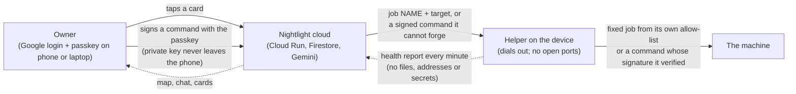

# Security model: a cloud command center you can trust

Nightlight is a cloud service that can act on people's real home and small-office servers. That is the whole point,
and it is also the thing that must be designed most carefully. This page is the threat model and the layers that
answer it, in plain words, for three readers: us later, the judges now, and anyone who runs the helper on a machine
they care about. Every statement describes the code in this repository; where it says "verified", a reference points
at the code. Anything we could not re-check is marked *(unverified)*.

Companion pages: [`SECURITY.md`](SECURITY.md) (the code-level details: surfaces, limits, scrubbing, quotas),
[`DESIGN-trust.md`](DESIGN-trust.md) (why we chose this design and what we rejected), [`PASSKEYS.md`](PASSKEYS.md)
(the passkey guide for owners), [`LIMITS-AND-ROADMAP.md`](LIMITS-AND-ROADMAP.md) (what is wrong and what comes next).

## Who can do what

The short version: **the cloud is a messenger, not a master.** It can ask a device for a named job from a fixed menu,
and the device checks that job against its own rules before running it. For anything outside the menu, the cloud can
only *relay* a command the owner's passkey signed; it holds no key that could sign one.

## Threats and the layers that answer them

### 1. Someone steals your Google login

A Nightlight session is a Firebase ID token from Google sign-in; the API takes your identity only from that verified
token (`api/src/nightlight_api/auth.py`). So a stolen login is a stolen Nightlight session. What can it do?

| Can | Cannot |
|---|---|
| see your map, health numbers, chat, notes and the scrubbed log lines you allowed | run a command on any device: expert commands and investigation grants need your passkey, and there is no email or SMS code fallback (`capabilities.py`: approval `"passkey"`; `expert.sign` requires a WebAuthn assertion with user verification) |
| approve cards from the fixed menu on your devices: restart an allowed container or failed service, a clean-up from the fixed list, remove a device, update the helper to a newer signed release | install anything the release key did not sign, or an older version (`update_helper` in the helper) |
| flip the app's permission switches on an app-managed device, within what that device itself reports right now | change a strict device's permissions, or switch a device between strict and app-managed (both only at the device: `nightlight settings`) |
| | switch expert sessions on for a device (pinned only at the device, `nightlight expert`) |

Known limit, stated plainly: ordinary cards have **no step-up authentication**; a signed-in session can tap Approve.
The passkey is required only where the blast radius is unbounded (a free command), see [`SECURITY.md`](SECURITY.md)
"Known limits". Removing a device is on the fixed menu, so a stolen login could uninstall the helper from your machines.

### 2. Nightlight's own cloud is compromised (or we turn malicious)

Assume an attacker controls the API and the database. The helper is written so that this is bad, not catastrophic:

- **Job names, not commands.** The server sends a job name and a target; the helper maps it to a fixed argument list
  with no shell and re-checks the target against its local allow-list and the target's current state (a container
  must exist and be stopped; a unit must be `failed`). Unknown job types do nothing. (`run_job` dispatch and the
  `_allowed` / `_from_remote` functions in the helper.)
- **Strict devices are closed.** In strict mode the local allow-list is final; nothing from the server widens it.
- **App-managed devices are a stated delegation.** The owner's switches in the app are applied by the helper, but only
  for targets the device itself reports right now (intersected on the device), and expert sessions can never be
  switched on this way ("pinned at the device: the app can't switch this on"). A malicious cloud could approve its own
  cards for those fixed jobs. It still cannot run any other command, touch unreported targets, read files, or change
  the mode.
- **Passkey-signed commands cannot be forged.** The cloud stores only the passkey's *public* key. A command runs only if
  the device verifies, with its own copy of that key, a signature over exactly this command, this device id, an expiry
  at most 15 minutes away and a one-time nonce (`expert_check` in the helper, verified with the system `openssl`). The
  device also checks the signature's web origin and relying-party hash against the ones the owner pinned. The cloud
  cannot even swap the key: the fingerprint the owner compares is computed on the device from the key bytes, never
  taken from the server.
- **Signed helper updates.** An update installs only if its ECDSA P-256 signature matches the release key built into
  the running helper, the version is newer and a self-test passes; the previous copy is kept for `nightlight rollback`.
  The release-signing key lives on the maintainer's machine, never in git, the image or the cloud; the deploy script
  refuses to ship a release whose signature does not match (`scripts/sign_helper.sh`, `scripts/deploy_api.sh`, per
  [`SECURITY.md`](SECURITY.md); a hardware module or an out-of-band CI signer is roadmap).
- **Keyless cloud.** The API reaches Firestore, Gemini and Memory Bank through its Cloud Run service identity
  (Application Default Credentials). There are no server-side API keys to steal; the only key in the browser is the
  public Firebase web config.

So the worst case of a fully breached cloud is: it can read what you let the helper send (health numbers, names,
scrubbed log lines), and it can trigger fixed-menu jobs on app-managed devices that the owner would otherwise have
approved by a tap. It cannot run a command, read a file, add a skill or push code.

### 3. A web page or a device's own data tries to steer the agent (prompt injection)

Container names, log lines, device names, notes and web search results all reach Gemini. The agent's charter says
that anything from a device or a web page is evidence, never an instruction (`agent.py`, system instruction and the
research tool). That rule alone would not be enough, so the design does not depend on it:

- The agent's action tools only **create cards**; nothing runs without a tap, and nothing outside the fixed menu runs
  without a passkey signature. A log line that "asks" for a command can at most produce a card you read.
- Under a read-only investigation grant the agent may propose commands freely, but the **device** decides what counts
  as read-only, by exact rules per program: a fixed list of programs from system folders only, their reading
  sub-commands, allowed options and value shapes, no pipes, redirects, chaining or substitution, file reads only under
  log folders, and nothing whose text looks like a secret (`readonly_command`, `_RO_RULES`, `_RO_SECRET_WORDS`).
- Discovery items use a fixed vocabulary the server checks; they cannot carry free text.
- Everything is scrubbed twice (device, then server) before it is stored or shown to the model (`redact.py`).

### 4. You lose your phone

Your passkey's private key is on the phone (or synced through its platform keychain). A finder cannot use it without
your face, fingerprint or PIN: every signature requires *user verification* and the helper rejects assertions without
the user-present and user-verified flags. The passkey is also useless without your Google login. What you can do:
remove the passkey in your platform's passkey manager (iCloud Keychain, Google Password Manager, Windows), and run
`nightlight expert --off` at each device to unpin it. Known limit: the app has no "remove passkey" button yet, and no
server-side revocation; see [`PASSKEYS.md`](PASSKEYS.md).

### 5. A curious demo visitor

Judges can try Nightlight three ways, and none reaches anyone else's data:

- **Sample home:** a simulation under an anonymous Firebase identity. Anonymous users cannot create join codes,
  approve pairing or add watched websites (`403 sign_in_required`), so no real device can ever be tied to a demo visit.
- **Live demo machines:** a pool of real VMs, one per visitor. Each visit signs in as its **own throwaway identity**
  (a custom token carrying the slot and lease id); the server maps it to the pool account only while that lease is
  current, and Firestore rules enforce the same (`firestore.rules`, `auth.py`). Visitors cannot unpair, replace or
  outlive the machine: pairing, removal, permissions, updates, settings and **passkeys** are refused for pool accounts
  (`POOL_DENY`, `POOL_FORBIDDEN_ACTIONS`, `live.forbid_pool`). When a visit ends (leave, 15 minutes idle, or 60 minutes
  hard cap) the account is wiped and the VM's boot disk is **restored from a golden snapshot**, so nothing one judge
  did reaches the next. A five-minute sweep stops any VM without a live lease.
- **Your own machine:** sign in with Google and install the helper; everything above applies.

### 6. Someone on your network, or on the internet, probes your devices

The helper opens **no listening port**: it dials out over HTTPS only (plain HTTP only to a local development server on
the same machine), never follows redirects, and asks the system's mDNS and the router's UPnP description without
listening for others (verified: no `listen`/`bind` in `helper/nightlight_helper.py`; `check_api`, `_NoRedirect`). On
a Mac, the firewall never asks. There is no SSH, no remote shell, no inbound path: the only way in is the job channel
the helper itself polls.

Device credentials: a device token is 256 random bits, returned once and stored only as a SHA-256 hash; join codes are
single use and expire in 10 minutes; pairing codes are approved by the owner and the token is minted in one
transaction. Tokens are revocable from the app or by uninstalling; they do not expire or rotate yet (roadmap).

## What never leaves a device

Host names, IP and hardware addresses, files, environment variables, passwords and keys are never collected. The
default device name comes from the hardware ("Mac mini", "Raspberry Pi"). Addresses of things nearby leave only as
keyed fingerprints (HMAC-SHA256 with the account's own key). Log lines leave only for targets the owner allowed, and
are scrubbed on the device first. The server's schema rejects any field it does not expect. Expert transcripts stay on
the device (`expert-transcript.log` in the helper's owner-only folder); only scrubbed output (at most about 3.5 KB)
is sent back. Details: [`SECURITY.md`](SECURITY.md) "What leaves the device". The device also keeps its own audit trail (helper
0.9.34+): one line per verified or refused signature (key fingerprint, nonce, expiry, the scrubbed command) and per exit
code, in the helper log and `expert-transcript.log`, shown by `nightlight audit` at the device; no output, tokens or
signature bytes.

## The trust ladder (sample home only)

On the simulated home, Nightlight earns freedom one kind of job at a time: after three approved successes of the same
kind, it may offer to handle that kind on its own; risky kinds have a ceiling and a failure moves it back a step
(`trust.py`). On real devices this does not apply: every restart, clean-up or removal waits for a tap, whatever the
level. We kept it that way on purpose until the fixed menu has more hours behind it.

## A reinstall keeps a device's history, without a new way in

Reinstalling the helper on the same machine can continue the same device on the map. The match is a hardware id
hashed on the device (`machine_fingerprint`: SHA-256 of the machine id, never the id itself) and keyed per account on
the server (HMAC). It is offered only at the owner's approval tap, never for a device that is still reporting, and
never across accounts; typed-code pairing without an approval tap always adds a new device (`real.py`, "a reinstall
continues the same device").

## What we don't protect against / known limits

- A signed-in session can approve fixed-menu cards without a second factor (no step-up authentication).
- A compromised cloud can trigger fixed-menu jobs on app-managed devices (a delegation the owner chose at install).
- An owner who signs a harmful command without reading it. The card shows the exact command, what it does and a risk
  badge; read-only grants are the default for investigations.
- Device tokens do not expire; `curl | sh` trusts the HTTPS origin; scrubbing is pattern-based and best effort.
- No "remove passkey" or "remove device token from the phone" button in the app yet; `nightlight expert --off` per
  device is the switch today.
- The Mac installer package is not yet Developer-ID signed (right-click > Open is needed).
- The full list, with root causes and what comes next: [`LIMITS-AND-ROADMAP.md`](LIMITS-AND-ROADMAP.md) and
  [`SECURITY.md`](SECURITY.md) "Known limits".

## Where this could go: a local-first Nightlight

Juan's original idea was an app that runs on the owner's own computer: the map, the agent and the job channel all at
home, with nothing of yours in anyone's cloud. The hackathon asks for a product hosted on Google Cloud, and that is
what we built; the design above is how we made a cloud command center trustworthy. A local-first version remains a
real direction, with real trade-offs:

| | Cloud Nightlight (today) | Local-first Nightlight (a direction) |
|---|---|---|
| Who you trust | Nightlight's cloud, bounded by the layers above | only your own machine (and the model provider for the agent's thinking) |
| Freedom | fixed menu plus passkey-signed commands | more: the agent could act with your own keys, like an administrator at your desk |
| Watching | always on, even when every machine at home is asleep or offline | only while the hub machine is on |
| From your phone, away from home | yes, with a tap or a passkey | needs a tunnel or relay of your own (Tailscale and the like), which is the hard part for a lay user |
| Setup | one install line or a package per device | a hub to run, plus the same helpers |

The two are not rivals: the same helper, the same fixed menu and the same passkey signing would work with a hub at
home as the command center. The cloud version is what makes the "house-sitter" promise (watching while you are away)
possible for people who will never run a hub; the local version is for people who want nothing in a cloud at all.
